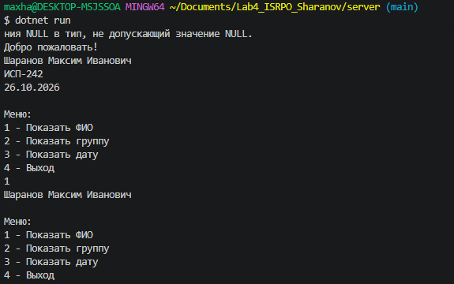
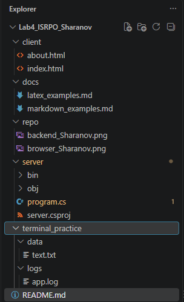
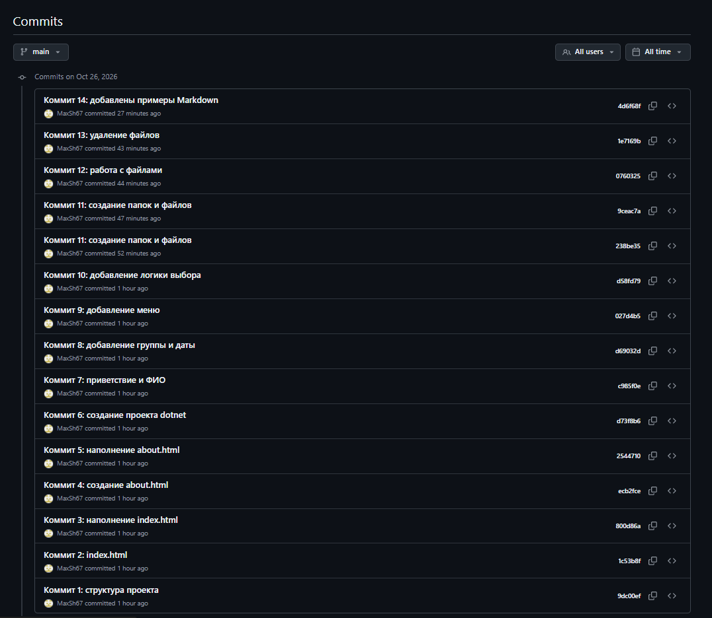

# Лабораторная работа №4. Закрепление навыков работы с Git, Markdown, терминалом и проектной структурой


**ФИО:** Шаранов Максим Иванович  
**Группа:** ИСП-242  
**Дата:** 26.10.2026

## Описание проекта

Учебный проект, в котором я закрепил навыки работы с Git и GitHub, Markdown, LaTeX и терминалом.

## Содержание

- [Структура проекта](#структура-проекта)
- [Примеры Markdown](#примеры-markdown)
- [Пример LaTeX](#пример-latex)
- [Ссылка на репозиторий](#ссылка-на-репозиторий)
- [Скриншоты](#скриншоты)
- [Заключение](#заключение)

## Структура проекта
```
Lab4_ISRPO_Sharanov/
├── README.md
├── client/
│   ├── about.html
│   └── index.html
├── docs/
│   ├── latex_examples.md
│   └── markdown_examples.md
├── repo/
│   ├── backend_Sharanov.png
│   └── browser_Sharanov.png
├── server/
│   ├── program.cs
│   └── server.csproj
└── terminal_practice/
    ├── data/
    │   └── text.txt
    └── logs/
        └── app.log
```

## Примеры Markdown

### Заголовок - H3
Это 3 заголовок

### Список
1. Первый пункт
2. Второй пункт
3. Третий пункт

### Картинка


### Код
```csharp
Console.WriteLine("Привет!");
```

### Пример LaTeX

Инлайн-формула: $a^2 + b^2 = c^2$

Блочная формула:

$$
\sum_{i=1}^n i = \frac{n(n+1)}{2}
$$

## Ссылка на репозиторий

[Открыть репозиторий](https://github.com/MaxSh67/Lab4_ISRPO_Sharanov.git)

## Скриншоты





## Заключение

*В ходе работы я закрепил навыки работы с Git и терминалом, научился оформлять документацию в Markdown и использовать LaTeX для формул. Все полученные знания я применил на практике.*
