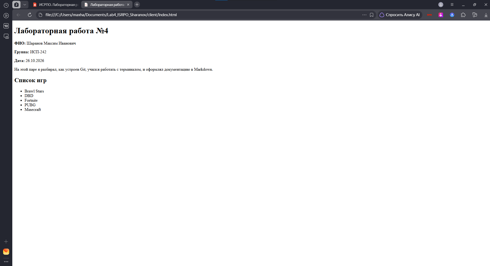

# Лабораторная работа №4
**ФИО:** Шаранов Максим Иванович  
**Группа:** ИСП-242  

---

## Заголовки всех уровней
# H1
## H2
### H3
#### H4
##### H5
###### H6

---

## Горизонтальные линии
---
***
___

---

## Форматирование текста
**Жирный**
*Курсив*
~~Зачёркнутый~~
`Моноширный`

---

## Списки

### Маркированный
- Первый
- Второй
- Третий

### Нумерованный
1. Первый
2. Второй
3. Третий

### Вложенный
1. Главный
   - Подпункт
   - Подпункт

---

## Цитаты
> Пример цитаты

---

## Блоки кода
```bash
git status
```

---

## Таблица
|1|2|3|
|:-|:-:|-:|
|A|B|C|

##  Картинка из папки repo/



## Ссылки
[Внешняя ссылка на GitHub](https://github.com)
[Внутренняя ссылка на цитаты](#цитаты)

## Чекбоксы
- [x] Сделано
- [ ] Не сделано

## Alert-блоки GitHub
> [!NOTE]
> ЗАМЕТКА

> [!WARNING]
> ОШИБКА!!!

## Inline LaTeX
$a^2 + b^2 = c^2$

## Block LaTeX
$$
\sum_{i=1}^n i = \frac{n(n+1)}{2}
$$